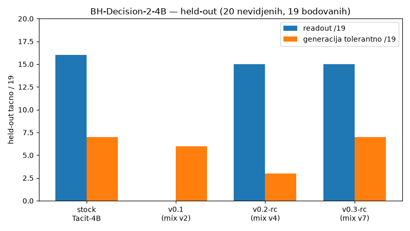

<div align="center">

# 🤖 BH-Decision

**Porodica modela za odlučivanje na bosanskoj ijekavici + engleskom**<br>
<i>3 veličine (2B/4B/9B) · jedan format podataka · zajedničke izlazne sheme · zajednički benchmark</i>

[](LICENSE)
[](#-testovi)
[](https://huggingface.co/datasets/BH-Language-AI/bs-decision-heldout-v01)
[](https://huggingface.co/BH-Language-AI/bh-decision-2-4b)
[](https://huggingface.co/collections/BH-Language-AI/bh-decision-6af57d53051dc84ba678cb41)
[](docs/benchmarking/anyjev-comparison.md)

Nosioci: **Kolektiv d.o.o.** + **Gamatrade d.o.o.** · Kontakt: xnetba@gmail.com<br>
Kraća engleska verzija: [README.md](README.md).

</div>

> ## 🏆 Najbolji rezultati
> | Šta | Skor | Gdje |
> |---|---|---|
> | **Stock Tacit-4B, readout** | **16/19 (84%)** | held-out v1 |
> | **vA / v0.5-rc (recept A) + readout** | **18/19 q1, 18/19 q3, 16/19 q2 — najbolji model** | held-out v1 |
> | v1.1 (mix v9) + readout | 17/19 q1 (89%) | held-out v1 |
> | v1.0 (mix v4) + readout, q2/q3 | 16/19 (84%) — paritet | held-out v1 |
> | v1.1 generacija (tolerantno) | 6/19 (32%) | held-out v1 |
> | Format (strogi JSON) | **18/20** (mix v9, rekord) | held-out v1 |
> | Jev 1.13 Free, DI staza | 14/14 (100%), p50 256 ms | 18 scenarija A/B |
> | Sudzuki-4b-cloud, DI staza | 15/18 (83%) | held-out v1 |
>
> Proizvodna konfiguracija: **vA (v0.5-rc) + AnyJev readout** = 18/19 (q1), 16/19 (q2), 18/19 (q3).
> Objavljene težine su još v1.1 dok upload v0.5-rc ne završi.
> Pravilo repoa: bez fabriciranja — svaka brojka ispod je iz stvarnog runa.

## Status (25.11.2026)

- FAZE 1–4 — gotove (istraživanje, arhitektura, dataseti/benchmark, infrastruktura).
- FAZA 5 — Linija 2 **v0.5-rc (vA, recept A: r32/rsLoRA/cosine/1024, mix v10)**:
  readout **18/19 q1, 16/19 q2, 18/19 q3** — iznad v1.1 na svim formulacijama,
  jedini dosljedni promašaj je strukturni 013 (choice bez apstinencije).
  Adapter povučen sa LUMI-ja (job 23962923), objavljen na
  [`BH-Language-AI/bh-decision-2-4b`](https://huggingface.co/BH-Language-AI/bh-decision-2-4b) 25.11.2026 (smoke OK).
  Ista težina i na Gen 1 repou [`BH-Language-AI/bh-decision-1-4b`](https://huggingface.co/BH-Language-AI/bh-decision-1-4b) (26.11.2026).
  SFT serija v1–vA: format popravljen podacima (0.05→0.90), prior mican (o2→o3→nijedan),
  rasuđivanje ostalo na stock nivou. Nalazi: [`docs/training/`](docs/training/).
- FAZA 6 (započeta) — **2B linija** [`BH-Language-AI/bh-decision-2-2b`](https://huggingface.co/BH-Language-AI/bh-decision-2-2b):
  v2b (Qwen3-1.7B + recept A) readout **13/19** vs stock 7/19; smoke OK 25.11.2026.
  Ista težina i na [`BH-Language-AI/bh-decision-1-2b`](https://huggingface.co/BH-Language-AI/bh-decision-1-2b) (26.11.2026).
- FAZA 6 (završena) — **9B linija** [`BH-Language-AI/bh-decision-1-9b`](https://huggingface.co/BH-Language-AI/bh-decision-1-9b):
  v1q (Qwen3.5-9B + recept A) readout **18/19 = stock 18/19 (paritet)**;
  val_loss 0.388, format 0.55; iskreno dokumentovan paritet, ne dobitak.
- DI staza — Core/MCP/Skill/Plugin gotovi (**71 test zeleno**); sudzuki-4b-cloud
  profilisan (15/18, ECE 0.16); izbor providera čeka cijenu/licencu.
  Vlastiti cjevovod ovdje ne radi bez ključa (Jev mrtav, Clef nema).

## 📊 Benchmark modela — held-out (20 neviđenih, 19 bodovanih)



| Verzija | Miks | val_loss | Generacija tol. | Generacija strogo | Readout q1 (q2/q3) | Status |
|---|---|---|---|---|---|---|
| stock Tacit-4B (baseline, nije naš) | — | — | 7/19 (37%) | — | 16/19 (13/15) | baseline |
| Linija-1 Ministral pilot | ~400 šablona, Kaggle QLoRA | 0.804 | 10/19 (rerun 6/19) | format 1.0 | — | pauzirano |
| v1 (bh-decision-2 v1) | 8474 (šabl.+thinking+conf+bos-core) | 0.80 | 4/15 (27%) | format 0.75 | — | arhiviran |
| v0.1 | mix v2 (4989), Kaggle QLoRA | 0.124 | 2/10 (20%) | 10/20 | — | release (nadmašen) |
| v3 | mix v3 (5189), LUMI bf16 | 0.0999 | 6/19 (32%) | — | — | arhiviran |
| v0.2 (= v4 težine) | mix v4 (5389, očišćen), LUMI bf16 | 0.1229 | 3/16 (19%) | 17/20 | 15/19 | release |
| v5 | mix v5 (3627, balansiran), LUMI bf16 | 0.1668 | 3/19 (16%) | 11/20 | 15/19 | arhiviran (bez priora nema rasuđivanja) |
| v6 | mix v6 (4543 dedup, 5 epoha), LUMI bf16 | 0.125 | — (sve odsječeno) | 0/20 | 15/19 | arhiviran |
| v0.3 (mix v7 5529 + v08) | LUMI bf16 | 0.158 | **7/19 (37%)** | 3/20 | 15/19 | release |
| v8 (mix v8 7529 + 2k EXT) | LUMI bf16 | 0.357 | 5/19 (26%) | 14/20 | ⏳ čeka cert | readout pending |
| 🥇 **vA / v0.5-rc (mix v10, recept A r32/rsLoRA/cosine/1024)** | LUMI bf16 | 0.432 | 5/19 (26%) | 4/20 (0.20) | **18/19 (16/18)** | ✅ **AKTUELNI NAJBOLJI (readout)** |
| v1.1 (mix v9 7729 + v09 reasoning) | LUMI bf16 | 0.413 | 6/19 (32%) | **18/20 (0.90)** | 17/19 (16/17) | release (nadmašen readoutom) |
| v1.0 (= v4 težine + q2/q3 protokol) | — | — | 6/19 (32%) | — | 16/19 | release (paritet) |

Eval set: [bs-decision-heldout-v01](https://huggingface.co/datasets/BH-Language-AI/bs-decision-heldout-v01) (zaključan, leakage 0).
Slike/grafike: bedževi su shields.io, graf je mjereni held-out (matplotlib, sirovi brojevi iznad).

<details>
<summary>📈 Decision Intelligence benchmark (18 scenarija, 9 bs + 9 en) — klikni za detalje</summary>

| Ruta | Tačnost (12.11.) | Rerun (13.11.) | p50 rerun | Reproducibilnost |
|---|---|---|---|---|
| A Jev-1.13-Free (hosted, $0) | 14/14 (100%) | **14/14** | 256 ms | bit-za-bit ✓ |
| B AnyJev Decider L0 (Tacit-4B, CPU) | 11/14 (79%) | **11/14** strogo | 17,1 s | 18/18 identično ✓ |
| C AnyJev Tacit L0 (CPU) | 11/14 norm. | **9/14** strogo (= 11 norm.) | 6,4 s | 18/18 identično ✓ |
| D Tacit Adaptive | 11/14 | nije ponavljan (D==C dokazano, cot 0/18) | — | — |
| E Clef lokalno | — | blokirano (treba GPU/download) | — | — |

Sirovo: `benchmarks/reports/live-{A-jev,B-decider-l0,C-tacit-l0,D-tacit-adaptive}.json`
+ `*-rerun-20261113.json`. Metodologija: `docs/benchmarking/anyjev-comparison.md`.

Agent sa skillom je brži i bolji: L0 je jedan forward (CPU) ili jedan hosted poziv (p50 256 ms);
svaka odluka nosi kalibrirano povjerenje; ispod praga 0.80 slijedi eskalacija.
Tok: zadatak → determinističko pravilo? → L0 → confidence ≥ 0.80? → izvrši, inače eskalacija.

</details>

## ✅ Testovi

| Sloj | Broj | Komanda |
|---|---|---|
| Python (pytest) | **24 zeleno** | `python3 -m pytest tests/ -q` |
| TypeScript (core/mcp/plugin/integracija) | **47 zeleno** | `node --experimental-strip-types --test tests/core/normalize.test.ts tests/core/providers.test.ts tests/core/anyjev.test.ts tests/mcp/server.test.ts tests/plugin/loading.test.ts tests/integration/project.test.ts` |

```bash
pip install pytest pyyaml
python3 -m pytest tests/ -q
python3 scripts/train.py --config configs/2b.yaml   # dry-run: samo validira i ispisuje plan
python3 scripts/evaluate.py --ref ref.json --pred pred.json [--out out.json]  # +Brier scoring
```

## 📁 Struktura

```
configs/         trening konfiguracije 2b/4b/9b
scripts/         train.py, evaluate.py (+Brier), build_bh2_mix*.py, readout_eval.py, readout_qsweep.py, readout_v*.py, pilot.py
slurm/ kaggle/  LUMI sbatch + Kaggle kerneli (mix v2–v9, svi runovi)
tests/           24 pytest + 47 TS (core/mcp/plugin/integracija)
docs/            izbor modela, arhitektura, odluke, trening (v1–v9 + readout izvještaji), provideri (jev/clef/sudzuki)
benchmarks/      harness (tačnost + Brier) + izvještaji
datasets/        train-mix-v1/v2, bh-decision-2 (mix v2–v9), expanded-v05..v09 human, heldout-v1 (zaključan), external (CSQA+QASC+ETHICS)
packages/        decision-core, decision-mcp, opencode-plugin
skills/          decision-intelligence (SKILL.md)
```

## Decision Intelligence staza (odvojeno od treninga)

Skill + MCP server + OpenCode plugin + zajednički Core. Ne mijenja trening kod: `packages/`, `skills/`, `config/`.

- Arhitektura: `docs/architecture/system-architecture.md`, `docs/architecture/decision-protocol.md`
- Provideri: `docs/providers/jev.md`, `docs/providers/clef-flash.md`, `docs/providers/sudzuki.md`, `docs/decisions/provider-selection.md`
- Instalacija: `docs/installation/opencode.md`, `docs/installation/local-clef.md`
- Verzije: basic (Jev Free) vs advanced (lokalni Tacit-4B) — `docs/installation/tiers.md`
- Privatnost: `docs/security/privacy.md` — Benchmark: `benchmarks/reports/phase-6.md`

## Licenca

Apache License 2.0 — vidi [LICENSE](LICENSE). Doprinosi: [CONTRIBUTING.md](CONTRIBUTING.md). Upravljanje: [GOVERNANCE.md](GOVERNANCE.md). Sigurnost: [SECURITY.md](SECURITY.md).

## Citiranje

Vidi [CITATION.cff](CITATION.cff).
