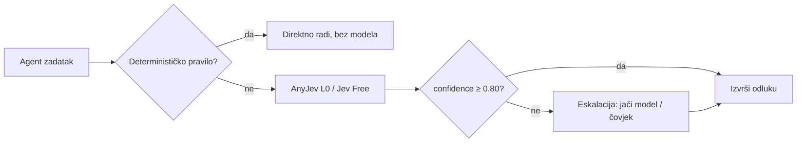

# BH-Decision

[](LICENSE)
[](#kako-pokrenuti-testove)
[](docs/benchmarking/anyjev-comparison.md)

Porodica modela za odlučivanje na bosanskoj ijekavici + engleskom: tri veličine (2B/4B/9B), jedan format podataka, zajedničke izlazne sheme, zajednički benchmark. Nosioci: Kolektiv d.o.o. + Gamatrade d.o.o. Kontakt: xnetba@gmail.com.

Primarni README na ijekavici: [README.bs.md](README.bs.md).

## Status (FAZA 1–4)

- FAZA 1 — Research & model selection: nacrt gotov, čeka odobrenje.
- FAZA 2 — Arhitektura i trening dizajn: sljedeća, treba odobrenje.
- FAZA 3 — Dataseti i benchmark: planirano.
- FAZA 4 — Infrastruktura (ovaj repo): u izradi — configi, skripte, CI testovi.
- FAZE 5–7 — Pilot trening, porodični trening, release: nisu počele. Bez GPU jobova i bez objava bez plana, licence i odobrenja.

## Struktura

```
configs/         trening konfiguracije 2b/4b/9b (infrastruktura; trening je FAZA 5/6)
scripts/         train.py (dry-run stub), evaluate.py (omotač oko harness-a)
tests/           pytest: protokol, dataseti, configi (samo stdlib + pytest)
docs/            model-selection, architecture, decisions (FAZA 1)
benchmarks/      harness (FAZA 3, još ne postoji)
datasets/        uzorci (FAZA 3, još ne postoje)
```

## Kako pokrenuti testove

```bash
pip install pytest pyyaml
python3 -m pytest tests/ -q
python3 scripts/train.py --config configs/2b.yaml   # dry-run: samo validira i ispisuje plan
python3 scripts/evaluate.py --ref ref.json --pred pred.json [--out out.json]
```

## Decision Intelligence staza (odvojeno od treninga)

Skill + MCP server + OpenCode plugin + zajednički Core (Jev 1.13 Free → lokalni
Clef-Flash, nulti trošak). Ne mijenja trening kod: `packages/`, `skills/`, `config/`.

- Arhitektura: `docs/architecture/system-architecture.md`, `docs/architecture/decision-protocol.md`
- Provideri: `docs/providers/jev.md`, `docs/providers/clef-flash.md`, `docs/providers/anyjev.md`, `docs/decisions/provider-selection.md`, `docs/decisions/anyjev-integration.md`
- Instalacija: `docs/installation/opencode.md`, `docs/installation/local-clef.md`
- Privatnost: `docs/security/privacy.md` — Benchmark: `benchmarks/reports/phase-6.md`

Testovi (bez ključeva/mreže): `node --experimental-strip-types --test tests/core/normalize.test.ts tests/core/providers.test.ts tests/core/anyjev.test.ts tests/mcp/server.test.ts tests/plugin/loading.test.ts tests/integration/project.test.ts`

## Decision Intelligence — agent radi bolje i brže / Better and faster with the skill

Bez skilla agent svaku mikro-odluku (klasifikacija, izbor alata, procjena rizika)
donosi punim reasoningom glavnog modela: sporo, skupo i bez kalibracije — model je
samouvjeren i kad griješi (Jev vraća confidence 1.0 i na pogrešnim odgovorima,
izmjereno). Sa skillom odluka ide brzom L0 putanjom s pragovima povjerenja:



**Brže:** L0 je jedan forward (Tacit, CPU) ili jedan hosted poziv (Jev, p50 256 ms);
harness overhead je reda milisekundi (mock p50 8 ms). Teški reasoning se pali samo
kad je opravdan (adaptive), a na mjerenom setu se nije morao paliti nijednom (cot 0/18).
**Bolje:** svaka odluka nosi kalibrirano povjerenje; ispod praga slijedi eskalacija
umjesto nagađanja, a `requires_escalation` nikad ne zaobilazi dozvole za destruktivne akcije.

### Izmjereno, ne obećano / Measured, not promised (18 scenarija, 9 bs + 9 en)

| Ruta | Točnost (12.11.) | Rerun (13.11.) | p50 rerun | Reproducibilnost |
|---|---|---|---|---|
| A Jev-1.13-Free (hosted, $0) | 14/14 (100%) | **14/14** | 256 ms | bit-za-bit ✓ |
| B AnyJev Decider L0 (Tacit-4B, CPU) | 11/14 (79%) | **11/14** strogo | 17,1 s | 18/18 identično ✓ |
| C AnyJev Tacit L0 (CPU) | 11/14 norm. | **9/14** strogo (= 11 norm.) | 6,4 s | 18/18 identično ✓ |
| D Tacit Adaptive | 11/14 | nije ponavljan (D==C dokazano, cot 0/18) | — | — |
| E Clef lokalno | — | blokirano (treba GPU/download) | — | — |

Sirovi rezultati: `benchmarks/reports/live-{A-jev,B-decider-l0,C-tacit-l0,D-tacit-adaptive}.json`
+ `*-rerun-20261113.json`. Metodologija i kalibracijski nalazi:
`docs/benchmarking/anyjev-comparison.md`. Pravilo repoa: bez fabriciranja —
sve brojke iznad su iz stvarnih runova.

## Licenca

Apache License 2.0 — vidi [LICENSE](LICENSE). Doprinosi: [CONTRIBUTING.md](CONTRIBUTING.md). Upravljanje: [GOVERNANCE.md](GOVERNANCE.md). Sigurnost: [SECURITY.md](SECURITY.md).

## Citiranje

Vidi [CITATION.cff](CITATION.cff).
